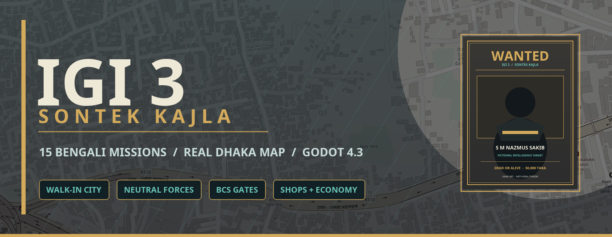
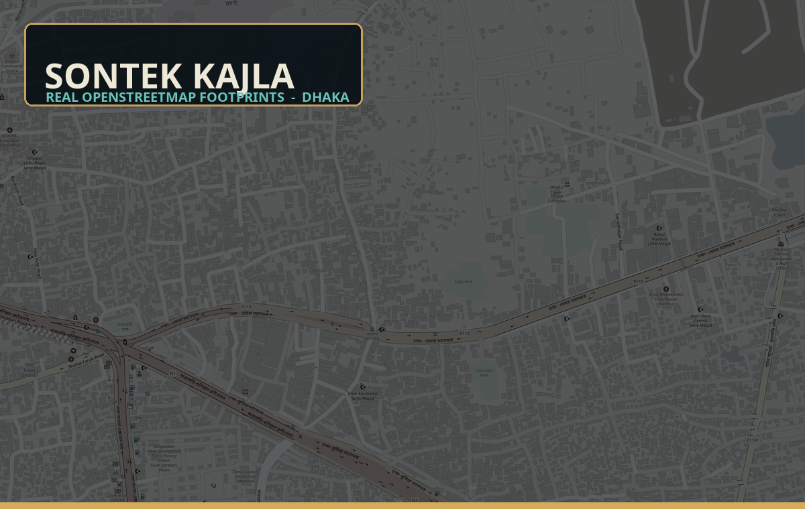
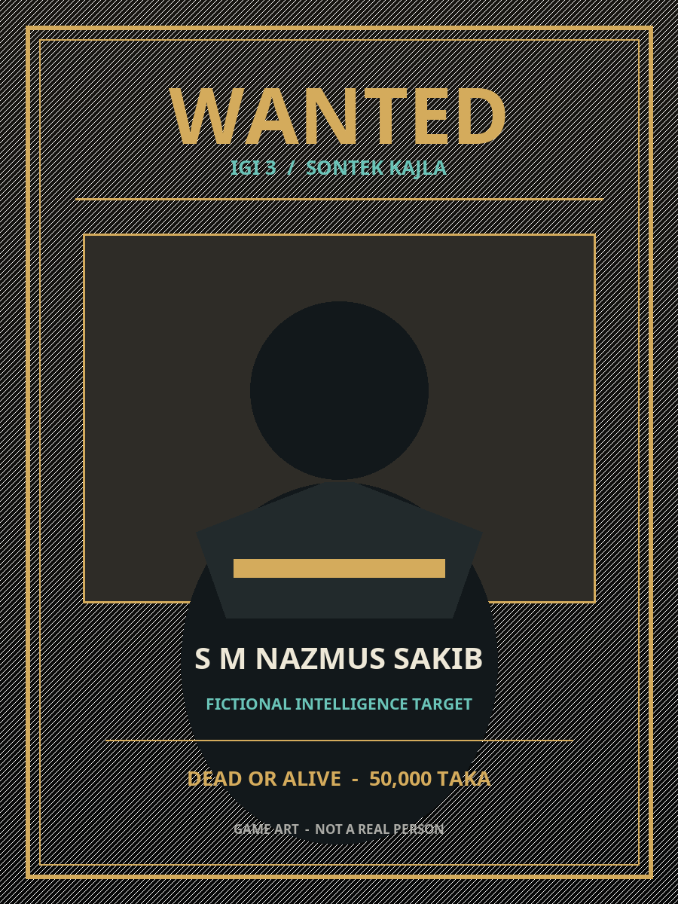
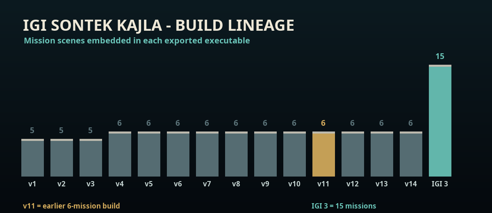

# IGI 3 — Sontek Kajla

[](https://github.com/Sakibpedia/igi3-sontek-kajla/actions/workflows/build_exes.yml)



**15 Bengali IGI-style stealth missions in a dense, shop-filled Sontek Kajla, Dhaka.**
Built with **Godot 4.3** from real OpenStreetMap footprints. Windows and Android builds are produced by GitHub Actions.

> সনটেক কাজলা — পালা বদলের আগে শত্রুদের চোখ এড়িয়ে চলুন।

| Engine | Platforms | Campaign | City | Status |
|---|---|---|---|---|
| Godot 4.3 (GL Compatibility) | Windows x86_64, Android | 15 missions, 7–10 objectives each | 1,500 OSM footprints, 30 shops | headless tests PASS |

## Play

1. Download `IGI3_SontekKajla.exe` from the [Releases page](https://github.com/Sakibpedia/igi3-sontek-kajla/releases) (or the **Actions → IGI3-SontekKajla-Windows** artifact).
2. Unzip if needed and double-click the `.exe`. No installation is required.
3. If Windows SmartScreen warns, choose **More info → Run anyway** (the build is not code-signed).

Keyboard/mouse controls are in [CONTROLS](#controls). The game is in Bengali with English mission subtitles.

## What is in the city

- **1,500 walk-in OSM buildings** across Sontek North, Sontek South and Sontek Main Road. Every building has a street door, interior floors with visible stairs, a lift shaft, windows (14,380 openings) and a reachable roof. One batched MultiMesh and a smart door proxy keep a mission load to ~24 s.
- **6 detailed feature towers** (5/6/8/10/12/15 floors) with physical stairs, 56 lift stops, roof huts and roof-to-roof plank bridges.
- **30 safe shops** of 8 types (pharmacies, clinics, arms dealers, grocery, general stores, mobile, tea stalls, hardware). Enemy loot can be sold; money and +25 HP upgrades persist between missions in `user://economy.cfg`.
- **Neutral forces that return fire**: 40 military (10 squads of 4), 40 police, 40 air force (a death calls 2 bombs on the attacker—take shelter), 40 naval commandos, 4 bomber commandos and 1 white-punjabi civilian protector. Killing an airman is dangerous.
- **6 kishor knife gangs** attack everyone, civilians included. **200 civilians** walk the lanes and can be wounded or killed.
- **IGI-style objectives**: photograph, collect, wiretap, sabotage, eliminate a commander, disable alarms, infiltrate, survive a hold, BCS-question gates (keys 1–4) and timed extraction. Every mission opens with a plane fly-over and a HALO jump.
- **Hero-only scope** (key 8 / right mouse). Thermal (T), binoculars (B), headphones (N), drivable vehicles (E), grenades/molotov/time bombs (4/5/6).

## Visuals





### Build lineage



`IGI_SontekKajla_v11.exe` is an **earlier build of the same game** (6 missions,
older neutral-force scripts), not a different game. v1–v3 had 5 missions and
v4–v14 had 6; the 15-mission dense-city rebuild shipped as "IGI 3" is what this
repository contains. See [docs/BUILD_LINEAGE.md](docs/BUILD_LINEAGE.md) for the
full binary survey and the preserved legacy build.

In-game IGI-style posters and leaflets live in `assets/textures/`. Six promotional poster SVGs (`poster_01` … `poster_06`, two in Bengali) are in [`docs/posters/`](docs/posters/). All three README images are generated locally from the project's own map and fonts with `python tools/make_readme_visuals.py`.

## Missions

| # | Mission | Sector |
|---:|---|---|
| 01 | Kajla Recon | North |
| 02 | Document Run | South |
| 03 | Park Stakeout | Park |
| 04 | R110 Sabotage | Highway |
| 05 | Final Sweep | Full map |
| 06 | Rooftop War | Rooftops (HALO insertion) |
| 07 | Diplomatic Compound | Full map |
| 08 | Motijheel Nightfall | Full map |
| 09 | Hatirjheel Bridge | Full map |
| 10 | Lalbagh Fort | Full map |
| 11 | Karwan Bazar | Full map |
| 12 | Airport Dawn | Full map |
| 13 | Buriganga Night | Full map |
| 14 | Parliament Zone | Full map |
| 15 | Final Operation | Full map |

Progress, medals, ranks and mid-mission checkpoints are saved automatically.

## Controls

```
WASD move        Shift sprint        Ctrl crouch/prone      C / Q lean
LMB fire         RMB aim             8 scope                 R reload
1-3 weapons      4 grenade           5 molotov              6 time bomb
E interact / shop / pharmacy / lift / vault window / photo / collect / drive
T thermal        N headphones        B binoculars           M map
Tab objectives   Esc pause           Keys 1-4 answer BCS gate questions
```

## Repository layout

```
project.godot              Godot 4.3 project (main scene: SontekMenu.tscn)
export_presets.cfg         Windows + Android export presets (relative output paths)
assets/                    OSM data/raster, fonts, vehicle models, audio, posters
scenes/                    Mission scenes M01.tscn – M15.tscn + menu
scripts/
  autoload/Game.gd         Campaign data, wallet, save files, Bengali strings
  world/KajlaMap.gd        Colony layout, shops, civilians
  world/LevelBuilder.gd    Walk-in houses, stairs, doors, windows, roofs
  world/IGIMission.gd      Objectives, spawns, navmesh, drops
  actors/PlayerController.gd, EnemyAI.gd, CharacterModel.gd
  ui/HUD.gd, SontekMenu.gd, UIStyle.gd
shaders/                   Character, face, world and screen FX shaders
tools/                     Map/audio generators, patch scripts, headless tests
docs/                      Design notes, poster SVGs, generated README visuals
.github/workflows/         Builds and tests the Windows .exe on every push
```

See [CITY_DESIGN.md](CITY_DESIGN.md) for the dense-city design notes and [docs/README_original.txt](docs/README_original.txt) for the original feature/verification notes.

## Build and test locally

Install Godot **4.3** and the standard export templates, then from this folder:

```powershell
# Import once, then run the headless regression suites
godot --headless --path . --import
godot --headless --path . res://tools/test/CityTest.tscn
$env:MISSION = '1';  godot --headless --path . res://tools/test/IgiTest.tscn
$env:MISSION = '15'; godot --headless --path . res://tools/test/IgiTest.tscn
Remove-Item Env:MISSION
godot --headless --path . res://tools/test/NeutralTest.tscn
godot --headless --path . res://tools/test/SaveTest.tscn

# Export the Windows build (writes build/IGI3_SontekKajla.exe)
godot --headless --path . --export-release "Windows Desktop"
```

To check **every campaign mission** in one go (M01–M15):

```powershell
powershell tools/test/run_all_missions.ps1 -Godot "C:\path\to\Godot_v4.3-stable_win64_console.exe"
```

Each test prints a `[CITY]`, `[IGI]`, `[NEUTRAL]` or `[SAVE]` **PASS** line and exits with code 0. Detailed click-by-click instructions are in [README_HOW_TO_BUILD.md](README_HOW_TO_BUILD.md) and [README_HOW_TO_DOWNLOAD.md](README_HOW_TO_DOWNLOAD.md).

**Verified on 2026-11-25 (Godot 4.3 stable):**

- City: 1,500 buildings, 6 feature houses (max 15 floors), 14,380 window openings, 30 shops (10 pharmacies), 200 civilians, 56 lift stops — PASS.
- **All 15 missions (M01–M15): PASS** — 7–10 objectives each, navmesh reachable, 1,500 buildings.
- Neutral forces: 165 actors, squad retaliation, airstrike call — PASS.
- Save system: checkpoints, medals, unlocks, ranks — PASS.
- Fresh Windows export from source — PASS (118 MB embedded-PCK executable); launched successfully.

Full results: [docs/VERIFICATION.md](docs/VERIFICATION.md).

## Credits and licensing

- **Game design, code and art:** S M Nazmuz Sakib.
- **Map data:** © [OpenStreetMap contributors](https://www.openstreetmap.org/copyright), available under ODbL 1.0.
- **Fonts:** Noto Sans / Noto Sans Bengali (SIL Open Font License).
- **Vehicle models:** CC0 models (`car.glb`, `cng.glb`, `pickup.glb`, `rickshaw.glb`).
- **Third-party editor addon:** `addons/asset_placer/` (Godot Asset Placer) is excluded from this repository because it requires Godot 4.4+ and is not used by the game.

No open-source license has been granted for the game code or original art. Third-party assets keep their own licenses; see [LICENSE_NOTES.md](LICENSE_NOTES.md).
